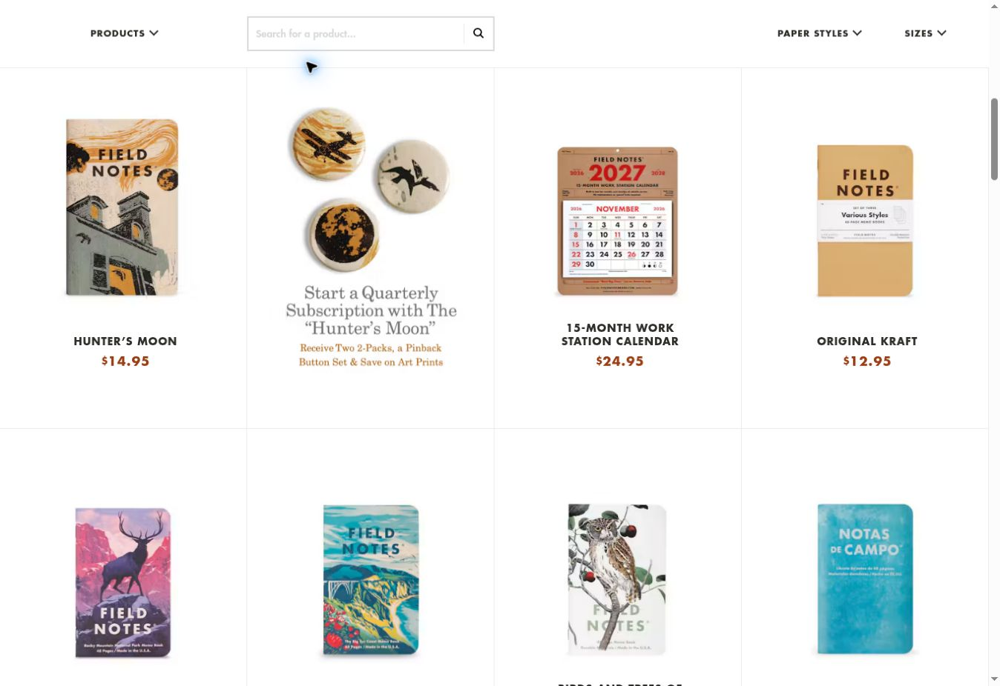
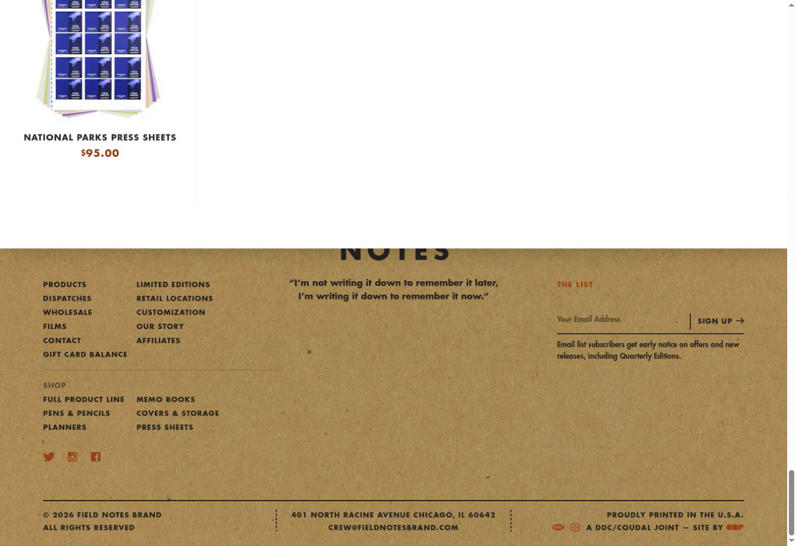
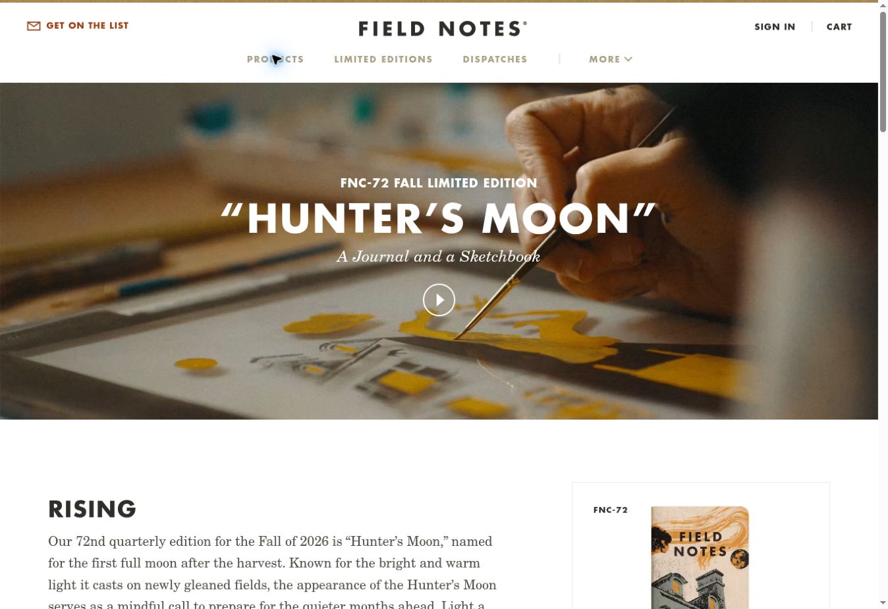
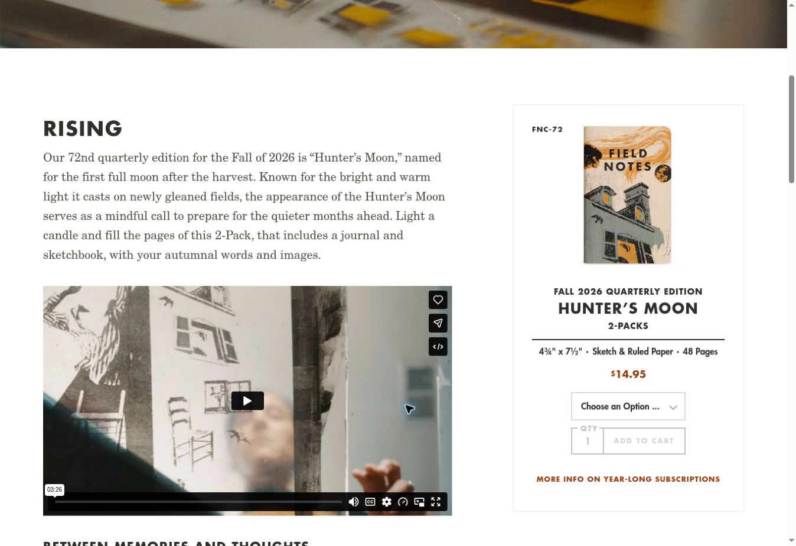

# Field Notes — E-commerce Course Project

This course project recreates selected pages of the Field Notes website using HTML, CSS, and JavaScript.

## Original website

- **Site name:** Field Notes
- **Official website:** https://fieldnotesbrand.com/
- **Hunter’s Moon product page:** https://fieldnotesbrand.com/products/hunters-moon

## Reference screenshots

These screenshots show the original Field Notes website, not the course-project implementation. Captured on October 26, 2026, in a desktop browser.

### Home page

Homepage header and featured products.

### Home page — product listings

Product filters and the visible product-card grid.

### Footer

Homepage footer with navigation, newsletter signup, and copyright information.

### Hunter’s Moon product page — landing view

Initial page view with the header and Hunter’s Moon cover.

### Hunter’s Moon product page — details

Product details, options, quantity control, and introductory description.

## Attribution

This is an educational project and is not affiliated with Field Notes. The original branding, website design, product imagery, and content belong to their respective owners.
